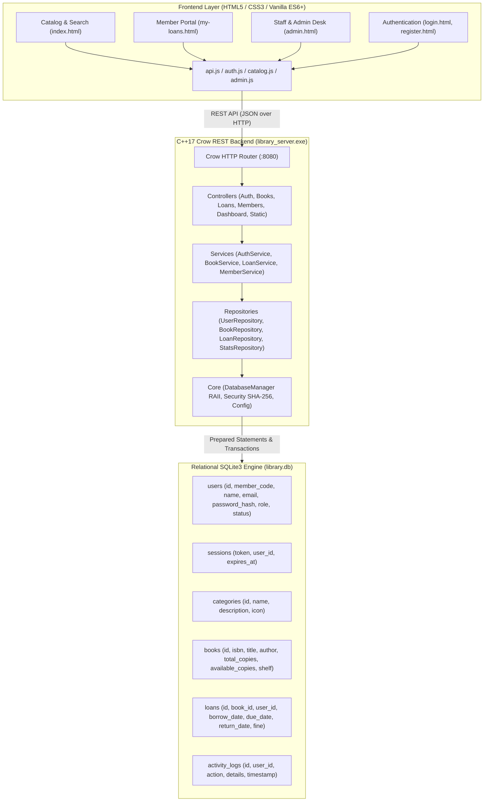
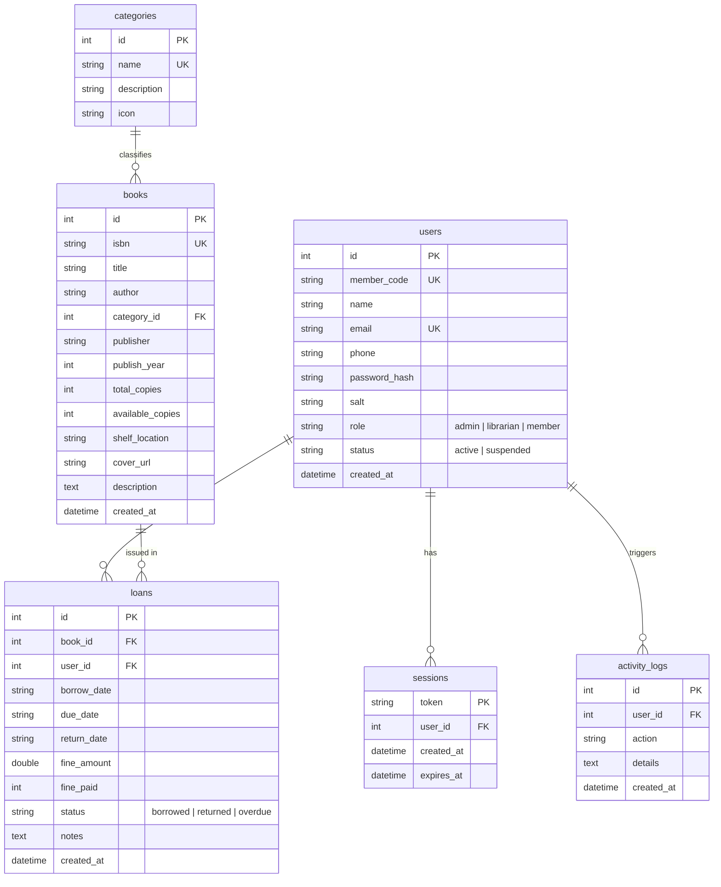

[README.md](https://github.com/user-attachments/files/34185159/README.md)
# 📚 LibroSphere — Modern Library Management System

> A high-performance, full-stack **Library Management System (LMS)** engineered with a modern **C++17 Crow REST backend**, persistent **SQLite3 relational database**, and a responsive **HTML5, CSS3, & Vanilla JavaScript** frontend.

---

## 🌟 Key Features

### 📖 1. Public & Student Catalog Portal (`index.html`)
- **Live Search & Filter**: Real-time debounce search by book title, author name, or ISBN-13.
- **Genre & Discipline Filtering**: Quick category pills for Computer Science, Literature & Fiction, Science & Mathematics, History, Business, and Philosophy.
- **Dynamic Stock Tracking**: Instant visual badges indicating live copies availability (e.g. `✓ 4 of 5 Available` vs `Out of Stock / Reserved`).
- **Book Details Modal**: Complete metadata view with publisher, publication year, physical library shelf coordinate (e.g. `Stack CS-01`), and synopsis.
- **One-Click Borrowing**: Authenticated members can check out books instantly for 14 days.

### 🎓 2. Member Portal (`my-loans.html`)
- **Digital Library Card**: Shows member code (e.g. `MEM-201`), membership status, and email.
- **Active Borrowed Books**: Live countdown badges showing remaining days or **⚠️ OVERDUE alerts** with real-time fine counter ($0.50/day).
- **One-Click Return & Fine Settlement**: Return books back to the catalog with real-time stock replenishment.
- **Borrowing Ledger & History**: Complete audit trail of past loans and return dates.

### 🏛️ 3. Staff & Librarian Operations Hub (`admin.html`)
- **Operational Overview**: Metric cards showing Catalog Titles, Total Copies, Borrowed Copies, Active Loans, Overdue Alerts, Registered Readers, and Pending Fines.
- **Circulation Desk (Fast Issue & Return)**:
  - **Issue Station**: Select available volume + member borrower + customize loan duration -> 1-click issue.
  - **Return Station**: Live list of active loans with 1-click return and automated fine calculation.
- **Inventory Management**: Searchable catalog table with full **CRUD** (Add New Book modal, Edit Book details, Delete Volume).
- **Member Directory**: View all readers, manage status (Activate / Suspend), and manage staff privileges.
- **All Circulation Records**: Filterable ledger by `Active`, `Overdue`, and `Returned` with complete fine audit.

### 🔐 4. Authentication & Security
- **Role-Based Access Control (RBAC)**: Supports `admin`, `librarian`, and `member` roles.
- **Salted SHA-256 Hashing**: 10,000-round key stretching with constant-time equality checks against timing side-channel attacks.
- **Session Tokens**: 64-character high-entropy cryptographic session tokens stored with expiration.
- **Instant Demo Logins**: 1-click switcher on `/login.html` for Admin, Librarian, and Student roles.

---

## 🏗️ System Architecture



---

## 💾 Relational Database Schema (`library.db`)



---

## 🔑 Pre-Seeded Default Accounts

| Role | Name | Identifier / Email | Password | Card Code |
| :--- | :--- | :--- | :--- | :--- |
| **Admin** | Chief Librarian | `admin` or `admin@librosphere.org` | `admin123` | `ADM-001` |
| **Librarian** | Sarah Jenkins | `sarah_lib` or `sarah@librosphere.org` | `lib123` | `LIB-101` |
| **Student** | Alice Reader | `alice_reader` or `alice@university.edu` | `alice123` | `MEM-201` |
| **Student** | John Doe | `john_doe` or `john@university.edu` | `john123` | `MEM-202` |

> *Tip: You can switch between demo accounts instantly using the 1-click buttons on [`login.html`](http://localhost:8080/login).*

---

## 🚀 How to Run the Server

### Option 1: Run the Precompiled Binary
The executable `library_server.exe` is already compiled and ready in the project root:
```powershell
.\library_server.exe
```
Then open your browser and navigate to:
**`http://localhost:8080`**

### Option 2: Rebuild from Source (MSVC + Ninja / CMake)
Open the Visual Studio x64 Developer Command Prompt and run:
```cmd
cl /EHsc /std:c++17 /O2 /utf-8 /D_WIN32_WINNT=0x0A00 /DNTDDI_VERSION=0x0A000002 /DASIO_STANDALONE /I include /I vendor\crow /I vendor\asio /I vendor\sqlite3 src\main.cpp src\core\DatabaseManager.cpp src\core\Security.cpp src\repositories\UserRepository.cpp src\repositories\BookRepository.cpp src\repositories\LoanRepository.cpp src\repositories\StatsRepository.cpp src\services\AuthService.cpp src\services\BookService.cpp src\services\LoanService.cpp src\services\MemberService.cpp src\controllers\AuthController.cpp src\controllers\BookController.cpp src\controllers\LoanController.cpp src\controllers\MemberController.cpp src\controllers\DashboardController.cpp src\controllers\StaticController.cpp src\seed\DatabaseSeeder.cpp ws2_32.lib wsock32.lib crypt32.lib winsqlite3.lib /Fe:library_server.exe
```

---

## 📡 REST API Reference

| Method | Endpoint | Description | Auth Required |
| :--- | :--- | :--- | :--- |
| `POST` | `/api/auth/register` | Register new member account | No |
| `POST` | `/api/auth/login` | Authenticate user, return session token | No |
| `GET` | `/api/auth/me` | Fetch active user profile | Yes |
| `POST` | `/api/auth/logout` | Invalidate session token | Yes |
| `GET` | `/api/books` | Search catalog with filters (`q`, `category`, `available`, `sort`) | No |
| `GET` | `/api/books/<id>` | Retrieve volume details by ID | No |
| `POST` | `/api/books` | Add new book to collection | Staff |
| `PUT` | `/api/books/<id>` | Update volume details & inventory | Staff |
| `DELETE`| `/api/books/<id>` | Remove book from catalog | Admin |
| `GET` | `/api/categories` | List all disciplines & book counts | No |
| `GET` | `/api/loans` | View all circulation records | Staff |
| `GET` | `/api/loans/my-loans` | View current member active loans & reading history | Yes |
| `POST` | `/api/loans/issue` | Check out book to member | Yes |
| `POST` | `/api/loans/return/<id>` | Return volume & compute overdue fine | Yes |
| `POST` | `/api/loans/pay-fine/<id>` | Settle overdue fine | Yes |
| `GET` | `/api/members` | Member directory listing | Staff |
| `PUT` | `/api/members/<id>/status` | Activate or suspend library card | Staff |
| `DELETE`| `/api/members/<id>` | Delete member record | Admin |
| `GET` | `/api/dashboard/stats` | Operational summary numbers & metrics | No |
| `GET` | `/api/dashboard/activity` | Recent circulation audit trail | Staff |

---

## 📁 Directory Structure

```
├── CMakeLists.txt              # CMake build configuration
├── library_server.exe          # Compiled native 64-bit C++ web server
├── library.db                  # Persistent SQLite3 relational database
├── include/
│   ├── core/
│   │   ├── Config.h            # Ports, business rules, fine rates, defaults
│   │   ├── DatabaseManager.h   # RAII SQLite connection, statements, transactions
│   │   └── Security.h          # SHA-256 salted password hashing & session generator
│   ├── models/
│   │   ├── Book.h              # Book domain model & JSON serializer
│   │   ├── User.h              # Member/User domain model
│   │   ├── Loan.h              # Circulation loan & fine calculator
│   │   ├── Category.h          # Genre/Category model
│   │   └── ActivityLog.h       # System event log model
│   ├── repositories/           # SQLite Data Access Layer (CRUD, Queries, Counts)
│   ├── services/               # Business logic (Loans, Books, Members, Auth)
│   ├── controllers/            # Crow REST route registrations
│   └── seed/                   # Database seeder with realistic initial books & accounts
├── src/                        # Complete C++ implementations (.cpp)
├── public/                     # Static Web Frontend
│   ├── index.html              # Public catalog & book search
│   ├── my-loans.html           # Member circulation portal & returns
│   ├── admin.html              # Staff circulation desk & inventory management
│   ├── login.html              # Sign in with 1-click demo switcher
│   ├── register.html           # New membership registration
│   ├── css/                    # Modular styling (variables, global, admin)
│   └── js/                     # Client scripts (API client, Auth, Catalog, Admin, Loans)
└── vendor/                     # Standalone header dependencies (Crow, Asio, SQLite shim)
```
